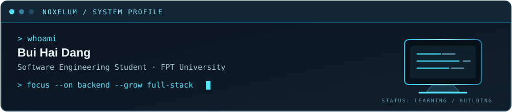
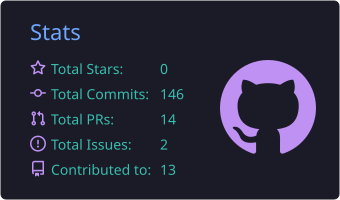
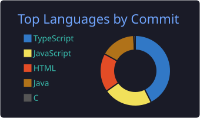
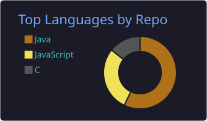
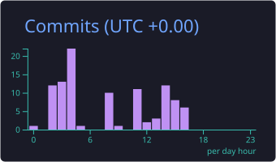

  

  

   

  
  
  

   

  
    <a href="#01--about-me">About</a> &nbsp;·&nbsp;
    <a href="#02--tech-stack">Stack</a> &nbsp;·&nbsp;
    <a href="#03--featured-work">Work</a> &nbsp;·&nbsp;
    <a href="#04--github-activity">Activity</a>
  

  

## `01` / About me

> **Software Engineering student @ FPT University** — backend-first, growing into full-stack.
> I like building practical things, shipping with a team, and understanding how software works *beyond* the code.

<table>
  <tr>
    <td width="50%" valign="top">
      <b>🔭 Working on</b> 
      Team projects and backend REST APIs
    </td>
    <td width="50%" valign="top">
      <b>🌱 Learning</b> 
      Node.js · TypeScript · React · Spring Boot · Docker · System design
    </td>
  </tr>
  <tr>
    <td valign="top">
      <b>🤝 Open to</b> 
      Open-source collaboration and web applications
    </td>
    <td valign="top">
      <b>💬 Ask me about</b> 
      Java · JavaScript · REST APIs · PostgreSQL · Git · Linux
    </td>
  </tr>
</table>

⚡ Fun fact: I enjoy Linux and customizing my development environment.

 

## `02` / Tech stack

| Domain | Stack |
|:--|:--|
| **☕ Languages** | &nbsp;&nbsp;&nbsp;&nbsp;&nbsp;&nbsp; `Java` · `JavaScript` · `TypeScript` · `SQL` |
| **⚙️ Backend & Web** | &nbsp;&nbsp;&nbsp;&nbsp;&nbsp;&nbsp;&nbsp;&nbsp; `REST APIs` · `Authorization` · `Validation` · `Swagger docs` · `Testing` |
| **🗄️ Database** | &nbsp;&nbsp; `PostgreSQL` · `MySQL` |
| **🧰 Tools** | &nbsp;&nbsp;&nbsp;&nbsp;&nbsp;&nbsp; `Git` · `Linux` · `Bun` · `Docker` *(learning)* |

 

## `03` / Featured work

### 🏟️ [Sports Center Management](https://github.com/HoiLauChay/sports-center-management)

A team-based full-stack application for sports center operations: **bookings, classes, memberships and reporting.**
My part is the backend — **REST APIs, authorization, validation, PostgreSQL, tests and Swagger docs.**

| Pull request | Scope |
|:--|:--|
| [**#229** · Reporting APIs](https://github.com/HoiLauChay/sports-center-management/pull/229) | Member, facility and course reports · permissions · validation |
| [**#224** · Booking & enrollment](https://github.com/HoiLauChay/sports-center-management/pull/224) | Booking and enrollment views · ownership and role checks |
| [**#227** · Coach class list](https://github.com/HoiLauChay/sports-center-management/pull/227) | Coach-scoped class list · enrollment counts · tests |

Project stack: `Bun` · `Turborepo` · `Express` · `Prisma` · `PostgreSQL` · `React` · `Vite` · `TanStack` · `Ant Design`

 

### 🚧 Personal projects

| Project | What it is | Stack |
| :--- | :--- | :--- |
| **[Focus Quest](https://github.com/NOXELUM/Focus-Quest)** 🚧 In progress | Gamified focus app — earn XP, level up, keep streaks and redeem rewards. | `React` `TanStack` `Ant Design` `Express` `SQLite` |
| **[SupportHub AI](https://github.com/NOXELUM/SupportHub-AI)** 🚧 Just started | Helpdesk / ticketing system with an AI assistant, built solo as a portfolio project. | `Spring Boot` `React` `TypeScript` `PostgreSQL` |

 

## `04` / GitHub activity

  
  
   
  
  
    
  <picture>
    <source media="(prefers-color-scheme: light)" srcset="https://raw.githubusercontent.com/NOXELUM/NOXELUM/output/pacman-contribution-graph.svg" />
    
  </picture>
   
  Cards and the Pac-Man graph are generated by GitHub Actions and may not include organization contributions.

 

  
   
  <b>FIND YOUR LIGHT IN THE UNKNOWN.</b> 
  NOXELUM &nbsp;·&nbsp; BUILD / LEARN / IMPROVE

