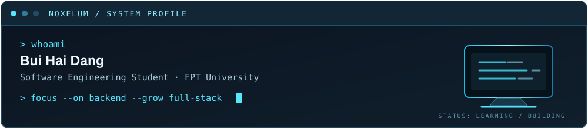

  

  

  
  
  

  

### `01` / About me

I'm a **Software Engineering student at FPT University**, focused on backend development while growing as a full-stack developer. I enjoy building practical applications, collaborating on real-world projects, and exploring how software works beyond the code.

- 🔭 **Working on:** team projects and backend REST APIs.
- 🤝 **Open to:** open-source collaboration and web applications.
- 🌱 **Learning:** Node.js, TypeScript, React, Spring Boot, Docker, and system design.
- 💬 **Ask me about:** Java, JavaScript, REST APIs, PostgreSQL, Git, and Linux.
- ⚡ **Fun fact:** I enjoy Linux and customizing my development environment.

### `02` / Tech stack

| Area | Technologies |
|:--|:--|
| **Languages** |     |
| **Backend / Web** |     |
| **Database** |   |
| **Tools** |    -101c28?style=flat-square&logo=docker&logoColor=56e5f6) |

### `03` / Featured work

#### [Sports Center Management](https://github.com/HoiLauChay/sports-center-management)

A team-based full-stack application for sports center operations, including bookings, classes, memberships, and reporting. My contributions focus on REST APIs, authorization, validation, PostgreSQL, tests, and Swagger documentation.

| Selected contributions | What I worked on |
|:--|:--|
| [Reporting APIs · PR #229](https://github.com/HoiLauChay/sports-center-management/pull/229) | Member, facility and course reports; permissions and validation |
| [Booking & enrollment · PR #224](https://github.com/HoiLauChay/sports-center-management/pull/224) | Booking and enrollment views, ownership and role checks |
| [Coach class list · PR #227](https://github.com/HoiLauChay/sports-center-management/pull/227) | Coach-scoped class list, enrollment counts and tests |

**Other repositories:** [Smart Warehouse Inventory Management](https://github.com/NOXELUM/Smart-Warehouse-Inventory-Management-System-SWIMS-) · [LAB211](https://github.com/NOXELUM/LAB211)

### `04` / GitHub activity

  
  

Third-party statistics may load slowly and don't always include organization contributions.

  
  <b>FIND YOUR LIGHT IN THE UNKNOWN.</b> 
  NOXELUM · BUILD / LEARN / IMPROVE

